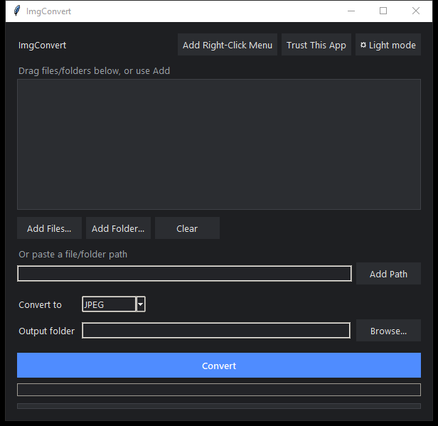

# ImgConvert

[](LICENSE)
[](#download)
[](https://github.com/248Tech/ImgConvert/releases/latest)

A small, fast, offline image converter for Windows. Drag files in, pick a format, done.



## About

ImgConvert batch-converts images between JPEG/JPG, PNG, WebP, GIF, TIFF/TIF, and HEIC/HEIF. It was built around a simple idea: a tool this small shouldn't come with an installer, an account, a subscription, or a network connection.

- **Lightweight** — a single portable `.exe` (~21 MB), no installer, no admin rights, no dependencies to set up.
- **Open source** — MIT licensed. Read every line, fork it, change it.
- **Ad-free** — no ads, no upsells, no "Pro" tier.
- **Doesn't phone home** — no telemetry, no analytics, no update-checker pinging a server. It never makes a network request. Your images stay on your machine.

## Features

- Batch convert between JPEG/JPG, PNG, WebP, GIF, TIFF/TIF, and HEIC/HEIF
- Drag and drop files or folders, or paste a path directly
- Windows Explorer right-click **Convert To** menu, per format, output next to the original file
- Automatic EXIF-orientation correction (fixes sideways/upside-down phone photos)
- Progress bar and a per-file success/failure log
- Light and dark theme toggle
- Code-signed executable

## Download

Grab the latest Windows exe from the [Releases](https://github.com/248Tech/ImgConvert/releases/latest) page — no Python install needed.

A [winget](https://github.com/microsoft/winget-pkgs) package (`248Tech.ImgConvert`) is pending review — once merged, you'll be able to run `winget install 248Tech.ImgConvert`. Track status: [PR #426950](https://github.com/microsoft/winget-pkgs/pull/426950).

## Running from source

```
pip install -r requirements.txt
python imgconvert.py
```

`tkinterdnd2` is optional — if it's missing, the app still works, you just use the "Add Files…" / "Add Folder…" buttons instead of drag-and-drop.

## Usage

1. Drag files/folders onto the window, click "Add Files…" / "Add Folder…", or paste a path directly.
2. Pick the target format from the dropdown.
3. Pick an output folder (defaults to a `converted/` subfolder next to the first file).
4. Click **Convert**.

Files that fail to convert (not an image, corrupt, etc.) are skipped and listed in the log — the rest of the batch still runs.

## Right-click "Convert To" menu

Click **"Add Right-Click Menu"** in the app's header to add a **Convert To** submenu (JPEG, PNG, WebP, GIF, HEIC, TIFF) to the Explorer right-click menu for supported image files. Pick a format and the converted file is written right next to the original — no need to open the app.

This writes only to `HKEY_CURRENT_USER`, so it applies to your Windows account and doesn't need admin rights. To remove it, run `ImgConvert.exe --uninstall-context-menu`.

## Windows SmartScreen / "Unknown publisher"

The exe is signed with a self-signed certificate — not one issued by a public CA, since that costs money and requires business identity verification. Its public half is embedded in the app itself (the private key never leaves the dev machine).

On a **new** PC, Windows will still show the SmartScreen warning once — click "More info" > "Run anyway". Then click **"Trust This App"** in the app's header: it silently imports the embedded public cert into that Windows account's Trusted Root + Trusted Publisher stores (no admin needed). After that, this exe — and any future release signed with the same key — won't be flagged on that account again.

## Contributing

Issues and pull requests are welcome. The codebase is a single file (`imgconvert.py`) by design — it's meant to stay small and easy to read end to end.

### Re-signing after a rebuild

If you're building from source and want a signed exe, it must be re-signed every time it's rebuilt (PyInstaller output isn't signed by default):

```powershell
$pfxPath = "signing\imgconvert_signing.pfx"
$plainPassword = Get-Content "signing\pfx_password.txt" -Raw
$securePassword = ConvertTo-SecureString -String $plainPassword -Force -AsPlainText
$cert = Get-PfxCertificate -FilePath $pfxPath -Password $securePassword
Set-AuthenticodeSignature -FilePath "dist\ImgConvert.exe" -Certificate $cert -TimestampServer "http://timestamp.digicert.com" -HashAlgorithm SHA256
```

## License

[MIT](LICENSE) — free to use, modify, and redistribute.
